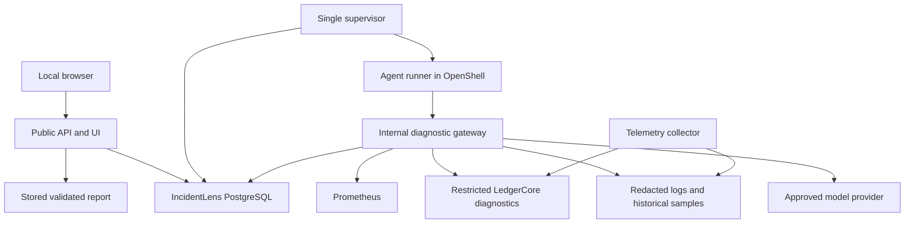

# IncidentLens — technical design and implementation specification

**Revision 1.0 · 4 November 2026 · Design only; application not implemented**

**Purpose:** investigate a backend symptom using bounded, read-only diagnostic tools and return an inspectable diagnosis supported by saved evidence. The developer decides and applies the fix.

This is the implementation contract for a fresher-sized first release. Requirements marked **MUST** are release gates. Numbers below are proposed limits or acceptance targets, not measured results. Commands and interfaces describe future implementation. Existing LedgerCore code and its documentation were inspected; framework documentation was checked on the revision date.

## 1. Outcome and exact scope

The user chooses the registered service `ledgercore-local`, supplies a symptom and a UTC time window, then receives a report containing findings, citations, alternatives, missing information and next diagnostic checks.

Version one supports one local developer, one registered application, one active investigation and a queue of at most ten waiting investigations. All traffic and accounts are synthetic. It diagnoses five fault classes: consumer unavailability, consumer slowness, rejected service credentials, database lock contention and connection-pool saturation. Healthy and insufficient-evidence cases are first-class outcomes. Authentication overhead and polling delay are possible contributors to consumer slowness, only when instrumented evidence supports them.

The target is an explanatory chain such as **slow password verification → slow delivery requests → delivery capacity below arrivals → growing pending queue**. When only the last two links are observable, the report MUST stop at those links and identify the missing measurement.

### Explicit exclusions

- No automatic repair, balance changes, outbox retries, process termination in the target application, deployment or configuration changes by the agent.
- No universal diagnosis of arbitrary services, automatic service discovery, arbitrary SQL, shell, browser, user-provided URLs or code execution tools.
- No model training, GNN, RAG index, multiple cooperating agents, Kubernetes or streaming data platform.
- No production banking deployment, availability guarantee or claim to have proved causality from correlations alone.
- No claim that the local fault suite is an established public benchmark.

### What completion means

There are two independent gates: **A. dependable diagnostic software** and **B. measured diagnostic usefulness**. Passing A does not imply B. A project may be mechanically correct while its model fails to outperform a fixed script. The final report must state both outcomes.

## 2. Technology decisions and reasoning

| Decision | Selected approach | Reason |
|---|---|---|
| Main language | Python 3.12 | One readable backend; direct model, HTTP and database integration |
| API and validation | FastAPI, Pydantic v2 | Explicit input/output schemas and generated OpenAPI |
| Database access | Psycopg 3 with a small connection pool and parameterized SQL | Transactions remain visible; no large repository abstraction |
| Durable state | Separate PostgreSQL 17 database with durability enabled | Jobs, evidence and reports share a clear transaction boundary |
| Agent loop | Small explicit Python loop; model adapter using LangChain Core/provider integration | Fixed action surface, predictable persistence and limits |
| Sandbox | NVIDIA OpenShell; pin a tested release | Reuse runtime isolation instead of building it |
| Telemetry | Prometheus, redacted JSON logs, periodic database samples | Enough historical evidence without a full observability platform |
| UI | Server-rendered HTML plus small JavaScript polling | Three screens; no separate frontend framework required |
| Deployment | Local Compose infrastructure plus an OpenShell-managed runner | Reproducible development with an explicit sandbox boundary |
| Tests | Pytest; real PostgreSQL integration tests; browser smoke check | Validate transactions and failure behaviour, not only mocked functions |

**Why not Rust for the whole system?** This workload is expected to spend much of its time in remote model and telemetry calls. Measure this expectation. Rust is already used inside OpenShell; another language boundary is not justified before a measured processing bottleneck exists.

**Why a small loop instead of the full Deep Agents harness?** Earlier discussion proposed Deep Agents. For this constrained diagnostic product, its general filesystem, shell, delegation and memory surface is unnecessary. The final v1 decision is an explicit loop with one authoritative persistence mechanism. Use LangChain's model integration, not Deep Agents' full runtime. This avoids maintaining application state and framework checkpoints with conflicting recovery semantics. Deep Agents remains a reference implementation, not a required dependency. Its documentation distinguishes the full harness from lighter alternatives [S2].

At Stage 0, pin exact tested package versions in `uv.lock`, container image digests, OpenShell CLI/gateway versions and a dated model identifier. Record them in `versions.json`. Do not invent a compatible lockfile in a design document or use moving `latest` tags in results. CLI and gateway versions must be compatible. A change to any of these requires rerunning the relevant contract tests.

## 3. Repository reuse and original work

| Repository | Used in v1 | Boundary |
|---|---|---|
| NVIDIA/OpenShell | Yes: sandbox lifecycle and access policy | It confines the runner; it does not diagnose LedgerCore or validate evidence |
| langchain-ai/langchain | Yes: model adapter and message/tool schemas | It calls the chosen model; our loop owns budgets, state and retries |
| langchain-ai/deepagents | Reference only | No installed full harness, implicit shell tools or subagents |
| NVIDIA/SkillSpector | Optional development check if a skill package is distributed | Scanner findings do not certify the product or its diagnoses |
| NVIDIA/NemoClaw | No | Adds a deployment layer unnecessary for one custom runner |
| AiSOC | Reference only | Do not copy a complete SOC workflow into this application |
| Kornia / Megatron-LM / FreeToken | No | Vision, large-scale training and model-serving optimization are outside scope |

OpenShell documents policy-controlled files and network access and an Apple Silicon macOS deployment path [S1]. SkillSpector provides static and optional LLM-assisted scanning of skill packages [S3]. Upstream license and attribution requirements must be retained if source is reused. Original work consists of adapters, telemetry contracts, orchestration, evidence persistence, validation, interface and evaluation suite.

## 4. Architecture and process boundaries



This is one application codebase with separate entry points, not a general microservice platform. The API/gateway, supervisor and collector run as host-side processes or containers. The runner alone executes in OpenShell. Their separate credentials define trust boundaries.

The browser reaches a loopback-only public listener, proposed port `8088`. The runner reaches a private internal listener, proposed port `8089`, reachable through the tested OpenShell gateway/network setup. Never assume that `localhost` inside the sandbox means the host. Stage 0 must demonstrate an allowed request to the internal gateway and a denied request elsewhere on the actual Mac/Linux setup.

The runner receives no database credentials or model-provider key. It receives only a random, short-lived capability for one investigation and one execution generation. It can call narrow internal endpoints. The gateway performs model calls and source queries, applies budgets, and stores results. Neither runner nor model receives the target application's administrative credentials.

The supervisor alone can create or stop the sandbox. It MUST NOT expose Docker sockets, its OpenShell administrative credentials or fault-injection controls to the runner. Internal network access is not enough: every internal request also authenticates its job capability and generation.

## 5. LedgerCore integration and evidence gaps

Inspected paths: `ledgercore/README.md`, `OutboxMetrics.java` and `OutboxPoller.java` under `src/main/java/io/github/harsha135135/ledgercore/outbox/`.

Observed design: Java/Spring modular monolith, PostgreSQL, one outbox poller, a demonstration consumer in the same application process. Existing outbox gauges include pending count, failed count and oldest-undelivered age. The README reports no distributed tracing. Successful delivery timing and an authentication breakdown are not established by those inspected files.

Do not describe the existing consumer as an independent deployed service. A local test-only consumer stub may be introduced for controlled failures; label it as a test fixture. Instrumentation additions need their own implementation and verification and MUST preserve ledger correctness.

Required instrumentation contract:

| Signal | Required behaviour |
|---|---|
| HTTP rate/errors/duration | Fixed route templates, status class, histogram units in seconds; no account/request IDs as metric labels |
| Outbox pending/failed/oldest age | Preserve current gauges; confirm exported Prometheus names through the actual registry |
| Committed event arrivals | Count durable committed outbox records by creation time; never count an attempted insert before commit as an arrival |
| Recorded publications | Count first durable `PUBLISHED` transitions; duplicate HTTP delivery attempts are a separate signal |
| Delivery attempt log | Event correlation ID, start/end, result category, status, duration; no event financial payload |
| Delivery timing | Correlated measurements of authentication and handler duration; unavailable if the selected auth path has no timer |
| Polling behaviour | Batch start/end, selected/published counts, configured delay; pauses are measured, not inferred only from settings |
| Pool | Active/idle/max, pending borrowers, acquisition timeout counter; confirm instrument export |
| Blocking history | Collector samples filtered PostgreSQL activity every 2 seconds, with actual timestamps and collection errors |
| Config history | Approved non-secret config snapshot at startup/change, application revision and instance ID |

Prometheus scrape interval is 5 seconds with 24-hour local retention. Tools use fixed query templates through its HTTP API [S4]; the model cannot submit PromQL. A rate or percentile is unavailable when samples are inadequate. Never average per-instance p95 values; aggregate appropriate histogram buckets first. The one-instance v1 contract must still record resets and gaps.

Arrival/publication rates use durable timestamp counts when available; separately reported process counters can undercount across a commit/process-crash gap. Their source semantics MUST be visible. Retain outbox rows for the evaluation window. A transition into FAILED, capture timing and samples taken at different instants can invalidate a naive `pending = arrivals - deliveries` calculation. Do not claim exact conservation from unrelated telemetry samples.

The collector's database connection is outside LedgerCore's application connection pool. If it used the same exhausted pool, it could fail precisely when needed. PostgreSQL activity is current state; history exists only because we record samples [S5]. Two-second sampling may miss shorter blocks. Absence of samples is not proof of absence of contention.

## 6. Time, scope and data quality

All stored timestamps are UTC RFC 3339 or PostgreSQL `timestamptz`. API windows use `[start, end)`. Resolve “last 15 minutes” once in the browser/API; persist absolute times. Do not silently slide the window during an investigation.

Allow windows from 1 minute to 30 minutes, ending no later than server time and starting within the past 24 hours. For an out-of-retention window return validation error. A valid but poorly covered window is accepted and marked incomplete.

Every tool envelope includes requested window, actual observation times, source revision, completeness, truncation and errors. Cross-source correlation uses overlapping timestamps and correlation IDs; unrelated samples cannot be described as one atomic system snapshot. Rate analysis for the normal benchmark uses at least 60 seconds of healthy sample coverage.

Historical window queries MUST NOT silently substitute current database state. `get_database_blockers` supports `historical` and `current` explicitly; current evidence is labelled as follow-up outside the incident window where applicable. Configuration from today cannot be asserted to have applied yesterday without a historical snapshot.

## 7. Public HTTP API contract

All public APIs except liveness require the local developer session. JSON uses snake_case. IDs are server-generated UUIDs. Lists use opaque cursors, stable `(created_at, id)` order, default limit 20 and maximum 100. Unknown fields are rejected. Responses never include internal capabilities or source credentials.

| Method and path | Success | Meaning |
|---|---|---|
| `POST /api/v1/session` | 204 | Exchange local access secret for a browser session |
| `GET /api/v1/session` | 200 | Current identity, expiry and CSRF token for this session |
| `DELETE /api/v1/session` | 204 | Revoke session |
| `GET /api/v1/services` | 200 | Registered service IDs, description and available capabilities |
| `POST /api/v1/investigations` | 202 | Create or replay an idempotent request; returns `Location` |
| `GET /api/v1/investigations` | 200 | Paginated history; optional status filter |
| `GET /api/v1/investigations/{id}` | 200 | Status, scope, progress, budget usage and report availability |
| `POST /api/v1/investigations/{id}/cancel` | 202 or 200 | Request cancellation; 200 if already terminal |
| `GET /api/v1/investigations/{id}/events?after_seq=0` | 200 | Ordered progress records; at most 100 per response |
| `GET /api/v1/investigations/{id}/evidence` | 200 | Paginated evidence metadata |
| `GET /api/v1/investigations/{id}/evidence/{evidence_id}` | 200 | Redacted saved observation; enforce parent ownership |
| `GET /api/v1/investigations/{id}/report` | 200 | Final structured report; 409 until available |
| `GET /api/v1/investigations/{id}/export?format=json` | 200 | Bounded report plus citations; `json` or escaped `html` |
| `GET /health/live` | 200 | Process responds; no dependency checks or sensitive detail |
| `GET /health/ready` | 200 or 503 | Database and schema usable; authenticated detail only |

Provider or telemetry outages do not make liveness fail. Service capabilities expose `available`, `degraded` or `unavailable`, separately from API readiness. A dead supervisor is exposed as a degraded execution capability and causes new submissions to receive 503 after its heartbeat is stale for 30 seconds.

### Create request and response

`Idempotency-Key` is mandatory on creation: 16–128 printable ASCII characters. Scope is developer identity plus endpoint, not session ID. Store the canonical body hash and job ID. Same key/same body returns the existing job ID with 202 and `replayed: true`, even if the job is now terminal; same key/different body returns 409. Retain keys as long as jobs (seven days). A retry after that horizon may create a new job and is documented as such. Use a unique constraint and one transaction, including the admission limit check under a singleton row lock.

```json
{
  "service_id": "ledgercore-local",
  "symptom": "Transfers succeed but notifications are delayed",
  "window": {
    "start": "2026-11-04T12:00:00Z",
    "end": "2026-11-04T12:15:00Z"
  },
  "profile": "standard"
}
```

```json
{
  "id": "8b9ef884-456a-4bce-8053-6cf8ad330129",
  "status": "QUEUED",
  "replayed": false,
  "status_url": "/api/v1/investigations/8b9ef884-456a-4bce-8053-6cf8ad330129"
}
```

`symptom` is 1–2,000 characters. Only profile `standard` exists in v1; the client cannot raise limits or choose arbitrary models. Total request body cap is 16 KiB. Dates above are examples, not defaults.

Errors have a stable machine-readable contract:

```json
{
  "error": {
    "code": "QUEUE_FULL",
    "message": "Ten investigations are already waiting",
    "retryable": true,
    "request_id": "bd85ab29-ec0f-4f2c-8244-e30744bf4929"
  }
}
```

Map 400 to malformed JSON; 401 to missing/expired authentication; 403 to permission/CSRF failure; 404 to absent or inaccessible IDs; 409 to idempotency mismatch or report not ready; 413 to oversized input; 422 to schema/window violations; 429 to queue or rate limits (`Retry-After` supplied); 503 to unavailable control-plane dependencies. Tool-source failures are persisted investigation observations, not automatically a failed public API request.

### Browser authentication

Generate a 32-byte random access secret during local setup and print it once to the developer terminal; do not commit it. Exchange it through the login form for a random server-side session with eight-hour absolute expiry. Store only session token hashes. Use an HttpOnly, SameSite=Strict cookie, restricted Host/Origin checks and CSRF tokens for mutations. Login requires the correct Origin and JSON content type; subsequent mutations require the session CSRF token in `X-CSRF-Token`, obtained from authenticated `GET /api/v1/session`. Bind to loopback; when deployed beyond loopback TLS and Secure cookies are mandatory and multi-user authorization is a new scope. No permissive CORS. Limit login attempts to five per minute; hide secrets in all logs.

## 8. Internal gateway contract

These routes use the private listener and job capability, never the browser session. Tokens are scoped to `(investigation_id, generation)`, expire at the job deadline, and are revoked on terminal transition or takeover. Every state write verifies current generation and lease under a row lock. Stale work cannot publish a final report.

| Method and path | Contract |
|---|---|
| `GET /internal/v1/jobs/{id}/context` | Scope, limits, saved observations, compact action history and capability list; no secrets |
| `POST /internal/v1/jobs/{id}/actions` | Persist and dispatch exactly one proposed `tool` or `model` action; required UUID `action_id` |
| `GET /internal/v1/jobs/{id}/actions/{action_id}` | Pending/completed/error/unknown status and stored response |
| `POST /internal/v1/jobs/{id}/report` | Submit typed report; validate and finalize transactionally |

`POST actions` returns 202 once the action reservation is durable. A small executor in the gateway runs it; do not use an untracked framework background task. On gateway restart, unfinished reservations become `UNKNOWN` for model calls and `INTERRUPTED` for reads. No action is automatically redispatched. A repeated action ID with identical input returns its saved state; a changed input returns 409.

The model request is assembled by the trusted gateway from the versioned system instructions and saved job history. The runner cannot replace the system prompt or supply arbitrary provider parameters. Model responses have exactly one discriminated action: `call_tool`, `submit_report` or `stop_inconclusive`. Tool arguments and report fields have schemas. Reject multiple proposed actions; at most one schema-repair model request is allowed and consumes budget. No raw shell/filesystem/provider tools exist.

Each action follows: validate → reserve budget and insert pending action → commit → external I/O with timeout → persist response/evidence and progress event → commit. Never hold a database transaction open during model or telemetry I/O. A lost response after persistence is recovered by polling the same action ID. Only read operations can be repeated after uncertain completion, with a new action ID and timestamps; model retry may incur another charge and consumes a fresh reservation.

Example action submission (the URL already supplies the job ID):

```json
{
  "action_id": "adc58018-b04d-4395-91dc-bf20cf302487",
  "kind": "tool",
  "tool": "get_database_blockers",
  "arguments": {"mode": "historical", "limit": 20}
}
```

For `kind: model`, allow only `action_id` and `kind`; the gateway builds all model input. The response contains `action_id`, `status` and a polling URL. Action status is `PENDING`, `RUNNING`, `SUCCEEDED`, `ERROR`, `UNKNOWN` or `INTERRUPTED`. Terminal action results are immutable. Polling never spends another action budget. The gateway executor uses a database claim and current job-generation check before dispatch; its in-memory queue is only a wake-up hint, never the source of truth.

The gateway allocates and persists `next_action_id` in job context before the runner can submit it. The runner MUST use that ID, not generate a new ID after reconnecting. Under the job row lock, accept only that next ID or an exact replay of an existing ID. When an action result is committed, persist the next ID and whether the next step is initial collection, a model decision, a tool observation or finalization. Context includes the last model decision and whether its proposed tool has already executed. This prevents a restart between a model decision and tool submission from accidentally executing the same decision twice. A deliberate retry advances to a new server-issued ID and consumes a new budget.

### Explicit runner algorithm

1. Fetch context and check status/deadline. On resume, recover a pending known action ID before requesting a new action.
2. Gather a small fixed initial bundle: request metrics and outbox statistics. Reuse already committed startup observations on resume.
3. Request one model decision from the saved observations and remaining capability list.
4. Validate the chosen action. If it is a permitted tool, submit and poll it, then return to step 3. If it repeats the same normalized arguments with no new observation opportunity, stop the loop or ask for one bounded alternative.
5. If it is a report, submit it for validation. If it is a request to stop, submit an inconclusive report with the missing evidence.
6. On budget/deadline/cancellation, obey the server state; the trusted supervisor/gateway supplies terminal cleanup and a fallback where appropriate.

Progress is measured by new evidence or a narrower supported explanation, not by the number of model messages. Tool calls are selected adaptively after the initial bundle; mandatory collection of every source on every run would remove the intended efficiency comparison.

## 9. Diagnostic tool interfaces

The registry binds `service_id` to fixed configured sources. URLs, paths, SQL, PromQL and headers are never model arguments. All tools return a shared envelope; arrays have limits and retain source ordering.

| Tool | Arguments beyond job scope | Output and implementation |
|---|---|---|
| `get_request_metrics` | `route_group`: transfers or consumer | Fixed Prometheus queries for rate, status counts, histograms and coverage |
| `get_outbox_stats` | none | Gauge history plus durable arrival/publication counts; pending/failed distinguished |
| `search_delivery_logs` | `outcome`: any/success/auth_error/network_error/server_error; `limit` ≤100 | Structured log rows filtered by window and fixed service; no arbitrary regex |
| `get_pool_metrics` | none | Active/max/pending/acquisition timeouts and scrape gaps |
| `get_database_blockers` | `mode`: historical/current; `limit` ≤50 | Sampled blocker edges, session role labels, wait duration if observed; no raw SQL text |
| `get_delivery_timings` | none | Correlated total/auth/handler durations, count and coverage; measured sequential components only |
| `get_runtime_config` | none | Allowlisted poll interval, batch size, worker count, authentication mode, revision and effective time |

Window, service and target instance are inherited from the job. The gateway can accept a narrower sub-window only within the job window; a current blocker snapshot is the sole explicit exception and is marked outside-window. A missing adapter returns `UNAVAILABLE`, never fabricated zeros.

Source timeouts: database 2 seconds per statement, HTTP connect 2 seconds/read 5 seconds, total tool deadline 8 seconds. Results cap at 64 KiB per tool and 1 MiB total stored evidence per job. Discard oversized fields before persistence, set `truncated: true`, and preserve enough metadata to explain the limitation. Redact before either storage or model submission. No secrets, account amounts, customer names, tokens or raw payment bodies are needed.

### Evidence envelope

```json
{
  "evidence_id": "0612caa2-4aa6-4d0a-8ec3-9200d21d7250",
  "tool": "get_outbox_stats",
  "requested_window": {"start": "2026-11-04T12:00:00Z", "end": "2026-11-04T12:15:00Z"},
  "collected_at": "2026-11-04T12:16:04Z",
  "coverage": "COMPLETE",
  "truncated": false,
  "source": {"kind": "postgres_aggregate", "instance": "ledgercore-local", "adapter_version": "1.0"},
  "data": {"committed_arrivals": 90000, "recorded_publications": 6300, "window_seconds": 900},
  "limitations": [],
  "errors": []
}
```

This example is hypothetical. Arithmetic belongs in deterministic tool code: these counts imply 100 arrivals/s and 7 recorded publications/s. They do not identify why publication is slow. Valid coverage states are `COMPLETE`, `PARTIAL`, `UNAVAILABLE`; truncation is independent. Empty complete log results mean no matching recorded events, not proof the event never occurred.

## 10. Restricted target access

Create a separate target diagnostic role. Grant SELECT only on approved diagnostic views and the minimum functions needed for filtering; never grant table updates, arbitrary privileged functions or application-admin APIs. Enforce read-only transactions and statement timeouts in addition to grants.

Full `pg_stat_activity` visibility can require elevated monitoring privileges. Prefer a narrowly defined, DBA-owned view/function returning only LedgerCore sessions and the required blocker metadata. Any SECURITY DEFINER function must use a fixed safe search path, qualified objects, no dynamic SQL, and PUBLIC execute revoked. This is a required review item, not a suggestion to give the agent broad `pg_monitor` access.

Target views proposed: committed-event counts by time, publication counts by time, current blocker relationships, and approved config versions. Database schema migrations for these views belong to a separate integration change. Source query indexes and maximum time-window costs must be tested before enabling repeated polling.

Logs and model outputs are untrusted data. Render all content escaped, retain log text as quoted observations, and reject any instruction embedded in a log to invoke a different endpoint or reveal secrets. Access controls must hold even if the model follows such text.

## 11. Job state machine and persistence

Execution status and diagnostic outcome are separate.

| Execution status | Meaning |
|---|---|
| QUEUED | Durable request waiting for supervisor |
| RUNNING | Claimed with generation, lease and active sandbox |
| CANCEL_REQUESTED | No new actions admitted; cleanup in progress |
| COMPLETED | Final report exists, including an inconclusive report |
| CANCELLED | Developer stopped the investigation |
| FAILED | Infrastructure/configuration failure prevented completion |

Report outcome: `SUPPORTED`, `TENTATIVE`, `INCONCLUSIVE` or `NO_FAULT_OBSERVED`. A budget expiry normally completes with a deterministic inconclusive report assembled from saved facts. It does not mean the application is healthy. A failed job has an infrastructure reason and any collected evidence but no diagnostic conclusion.

Allowed transitions: QUEUED→RUNNING/CANCELLED/FAILED; RUNNING→COMPLETED/CANCEL_REQUESTED/FAILED; CANCEL_REQUESTED→CANCELLED; expired RUNNING→QUEUED for a bounded recovery or FAILED. Terminal states are immutable. New investigations may refer to old IDs but never reopen them.

### Storage schema

| Table | Key fields and constraints |
|---|---|
| `investigations` | UUID PK, owner, service, symptom, window, status, generation, lease_until, started_at, deadline, recoveries, cancel time, next_action_id, next_phase, counters, final reason |
| `submission_keys` | UNIQUE(owner, endpoint, key), request_hash, investigation FK |
| `actions` | UUID PK, investigation FK, generation, kind, canonical input hash, status, reserved tokens, provider request ID if available, response JSON, timestamps |
| `evidence` | UUID PK, action FK UNIQUE, investigation FK, redacted envelope JSONB, SHA-256, byte count |
| `progress_events` | investigation FK, sequence, type, redacted payload, timestamp; UNIQUE(investigation, sequence) |
| `reports` | investigation FK UNIQUE, schema_version, outcome, typed report JSONB, model/prompt versions |
| `telemetry_samples` | service, kind, observed_at, collector version, payload, coverage; index(service, kind, observed_at) |
| `sessions` | session token hash, identity, expiry and revocation |
| `control` | singleton row for admission and coordination metadata |

Insert evidence, mark its action complete and append the progress event in one transaction. Store the report, append its event and move to COMPLETED in one transaction. Evidence hash detects accidental modification; it is not a cryptographic proof against a database administrator. Application roles cannot edit individual finalized observations. Scheduled retention deletion is a separate privileged operation.

Keep jobs, evidence, reports and submission keys for seven days, telemetry for 24 hours. Do not delete active jobs or their referenced evidence. Exports are explicit downloads and are not automatically uploaded elsewhere. Backup/restore must preserve related rows and successful report references.

## 12. Dependable execution and recovery

One supervisor owns a dedicated PostgreSQL advisory-lock connection. A second supervisor exits instead of executing jobs. If that connection is lost, stop launching work and stop the active runner; generation fencing remains the final protection against stale writes.

Claim the oldest queued job in a short transaction, increment its generation, establish a 30-second lease, issue a new capability and record the sandbox name. Supervisor refreshes its heartbeat and the job lease every 5 seconds while the runner is alive. It also enforces the absolute deadline and watches runner exit. A heartbeat alone is not proof of progress.

Initial deadline: 180 seconds after first claim, including sandbox startup. Queue wait expires after 10 minutes. Recovery never resets deadline or budgets. Maximum two recoveries. After lease expiry, invalidate capability/generation before starting another runner, and terminate the old named sandbox where possible. A stale runner receives 409/403 and cannot finalize anything.

| Failure | Required result |
|---|---|
| Browser closes | Job continues; reopening displays persisted status |
| Runner dies after saved evidence | Resume from context with same evidence; do not repeat completed actions |
| Tool response lost after save | Poll existing action ID; no second query |
| Gateway dies during read | Mark interrupted; a new bounded read may occur, retaining distinct timestamps |
| Gateway dies during model call | Mark unknown; retain worst-case reservation; no claim of exactly-once billing |
| Model 429 or 5xx | At most one explicit retry if deadline/budget allow; capped Retry-After; fresh action reservation |
| Model malformed output | One repair opportunity within budget; otherwise deterministic inconclusive report |
| Target source unavailable | Save unavailable observation; continue with other tools |
| IncidentLens database unavailable | Fail closed: no new source/model calls without durable reservations; recovery after DB returns |
| Cancellation races completion | Lock job row; first committed terminal decision wins; cancellation never rewrites a completed report |
| Cancellation during external call | Revoke capability, cancel local request; late results cannot complete job; remote provider may still bill |
| Deadline exceeded | Stop new actions; save bounded inconclusive report and terminate runner |

This is at-least-once execution of repeatable reads with deduplication of committed action results. Do not claim exactly-once external execution. Read-only target tools are important to making interruption recovery safe.

## 13. Budgets and predictable resource use

| Limit | Standard profile |
|---|---:|
| Active jobs / queued jobs | 1 / 10 |
| Total job deadline | 180 seconds from first claim |
| Model actions, including retry/repair | 8 |
| Diagnostic tool actions, including retries | 12 |
| Parallel actions per job | 1 |
| Input per model call | 6,000 tokens maximum |
| Output per model call | 1,500 tokens maximum |
| Total reserved input + output | 40,000 tokens |
| Model request timeout | 25 seconds |
| Stored evidence per job | 1 MiB |
| Report size | 32 KiB |
| Sample log rows per tool | 100 |

The gateway reserves estimated input plus the maximum output before each call using the selected model's tokenizer. Stage 0 must verify token accounting for that model. A completed call reconciles actual usage; unknown usage retains its reservation. Cumulative reserved/used counters survive restart. Never silently truncate essential source metadata to fit a prompt: select summaries with links to evidence and mark omissions.

Dollar cost is an estimate from a versioned pricing file plus provider usage, displayed with its pricing date. Token/call/deadline limits are enforced; they are not a universal hard guarantee of provider billing because tokenizer discrepancies and uncertain responses exist. Configure a provider account budget separately for the local pilot.

## 14. Report schema and validation

Each report contains `schema_version`, `outcome`, `summary`, `findings`, `alternatives`, `limitations`, `next_checks` and `usage`. A finding has `claim`, `support` (observed/inferred), `evidence_ids` and `reason`. No uncalibrated numerical confidence score.

Example finding: “Recorded event publication throughput was below committed arrival throughput throughout the covered interval.” Support this with overlapping-window measurements. “Password verification caused the slowdown” additionally requires correlated timing evidence and comparison to relevant baseline data; otherwise use tentative wording and name the missing check.

Deterministic validation MUST ensure parent-owned evidence references, schema correctness, valid source windows, bounded lengths and accurate tool-calculated arithmetic. Required limitations for unavailable/truncated sources are merged by code and cannot be removed by the model. Unknown evidence IDs get one report repair opportunity only if a model budget remains, then an inconclusive fallback.

These checks do not prove semantic entailment. The evaluator and human reviewer judge whether cited evidence actually supports a claim. Distinguish observed facts, inferred mechanisms and causal confirmation. Controlled interventions establish ground truth in the test harness; the diagnostic agent never performs interventions on its own.

The following is a minimal valid report payload. `usage` is added by the server from action records; any model-supplied usage field is rejected. Empty alternatives are permitted but must not be interpreted as all other causes having been ruled out.

```json
{
  "schema_version": "1.0",
  "outcome": "TENTATIVE",
  "summary": "Recorded publication throughput was below event arrival throughput",
  "findings": [
    {
      "claim": "The covered window contains 100 arrivals/s and 7 recorded publications/s",
      "support": "observed",
      "evidence_ids": ["0612caa2-4aa6-4d0a-8ec3-9200d21d7250"],
      "reason": "Durable counts divided by the same 900-second interval"
    }
  ],
  "alternatives": [],
  "limitations": ["No delivery timing breakdown was collected; the internal cause remains unknown"],
  "next_checks": ["Collect correlated consumer request timing for this incident window"]
}
```

Limit summary to 1,000 characters, findings to eight, evidence references per finding to ten, and alternatives/limitations/next checks to ten entries each. `alternatives` entries have `hypothesis`, `assessment` (supported/weakened/unassessed), `evidence_ids` and `reason`. All explanatory strings are capped at 2,000 characters. The overall byte limit still applies. The example's citation resolves only in a job containing that example observation; real reports use their actual IDs.

## 15. Interface and user journey

Three screens only:

1. **Start:** registered service selector, symptom, absolute/relative time picker, known telemetry availability and Investigate button. Disable duplicate submit while retaining the generated idempotency key for network retries.
2. **Progress:** status, elapsed time, calls used and factual action timeline. Poll status/events every 2 seconds while visible; back off to 10 seconds after errors and stop at terminal state. Cancel button; no internal chain-of-thought stream.
3. **Report:** finding first, clickable evidence, alternatives, limitations and next checks. Evidence panel shows source, observation time and coverage. JSON/HTML export.

Budget exhausted, source missing and no fault observed must look different. Display “diagnosis supported in observed window,” not “system fixed.” Logs are rendered as text; HTML exports are escaped and contain no scripts or external resources. UI needs keyboard navigation, visible loading/error states and readable mobile layout.

## 16. Evaluation contract

Freeze prompts, model version, adapter code and thresholds before opening held-out evaluation results. Developer-visible fault labels exist only in the test controller, never in logs, config names, prompts or paths accessible to the agent. Use neutral instance names. The controller stores injection time, cause and expected observable mechanism separately.

Initial pilot: two faults (unavailable vs slow consumer) plus healthy runs. The demo consumer is currently in-process; use a test-only configurable downstream stub or isolated fault hooks to change response behaviour without taking down the whole application. The agent has no route to these controls.

Full suite: 35 development cases and 35 held-out cases: five variants for each of five fault classes plus healthy and missing-evidence categories. Each case runs three times per system (105 held-out runs per system). Vary timing, load, affected operation and distracting benign messages. Hold out templates, not merely random seeds. This small suite supports scoped claims only; it does not establish generalization to unseen companies or arbitrary root causes.

Baselines share service access, time windows and limits: (A) deterministic diagnostic rules over a fixed collection bundle; (B) one LLM report from that bundle; (C) adaptive agent. For live comparisons reproduce isolated scenario runs with matched workload seeds and randomize execution order. For exact observation comparisons use frozen recordings and label them replay evaluation. Do not compare a healthy later run against an earlier failing run.

Metrics: correct primary cause, correct causal depth, unsupported-claim rate, citation relevance, healthy-case false alarms, appropriate abstention, elapsed time, calls and estimated cost. Mark cases invalid if fault injection or minimum telemetry coverage failed; report invalid counts and rerun them, never silently discard difficult valid cases. Labels and numeric checks are deterministic; review ambiguous explanations against a written rubric without knowing which system generated them. An LLM judge alone is insufficient.

Proposed usefulness gate: at least 80% correct primary causes on valid fault runs; at least 80% appropriate abstention on insufficient-evidence runs; at most 10% false alarms on healthy runs; every factual finding has valid references; at most 5% unsupported factual findings by manual rubric. Also show a useful trade-off against the stronger baseline: at least 10 percentage points higher diagnosis accuracy, or at least 20% fewer tool calls with accuracy within 2 percentage points. Report counts, per-class outcomes and case-clustered uncertainty; these thresholds are project acceptance targets, not promises. If the gate fails, report that honestly and do not add frameworks to disguise the result.

## 17. Reliability and security acceptance tests

Required tests exercise behaviours, not only implementation details:

- Concurrent repeated create requests yield one job; changed-body reuse returns 409.
- Queue admission never exceeds its cap under concurrent requests.
- Old generation cannot append evidence or complete a report after takeover.
- Kill runner after evidence commit and before response receipt; restart reuses the record.
- Kill gateway during a model action; unknown charge retains reservation and retries remain bounded.
- Cancel while a tool is in flight; no subsequent model action starts and no completed report is published afterward.
- Fail IncidentLens DB; no unrecorded source or model work starts.
- Fail one telemetry source; report displays its loss and does not convert it into a healthy result.
- Historical query never substitutes current blockers without a clear explicit mode.
- Read-only credential cannot mutate target tables; timeout terminates an expensive permitted query.
- Log text containing instructions cannot cause forbidden tool names, destinations or source writes.
- OpenShell blocks unapproved egress and host-secret paths; approved gateway access works.
- Login/CSRF/ownership checks and escaping prevent cross-job reads or executable report content.
- Backup and restore IncidentLens DB to a fresh instance; completed reports retain citations, pending jobs recover without budget reset.

Use real PostgreSQL for transactions, admission, leases and recovery. Mock provider responses only for deterministic failure tests; at least one real provider end-to-end test and sandbox test is required. No performance claims from fake provider timings.

## 18. Implementation layout and coding style

Proposed future layout:

```text
incidentlens/
  docs/TECHNICAL-DESIGN.md
  pyproject.toml
  uv.lock
  versions.json
  src/incidentlens/
    config.py
    schemas.py
    api.py
    internal_api.py
    auth.py
    database.py
    jobs.py
    supervisor.py
    runner.py
    model_gateway.py
    evidence.py
    reports.py
    collector.py
    tools/
      registry.py
      metrics.py
      outbox.py
      logs.py
      blockers.py
      config_snapshot.py
    templates/
    static/
  migrations/
  tests/unit/
  tests/integration/
  tests/e2e/
  evaluation/scenarios/
  evaluation/results/
  deploy/compose.yaml
  deploy/openshell/
  scripts/
```

Use explicit dataclasses/Pydantic models and small functions with named responsibilities. Start with direct SQL in one persistence module per responsibility. No generic workflow DSL, plugin discovery, inheritance hierarchy, metaprogramming or custom dependency-injection framework. One function validates a request, another executes a query, another persists an observation. Comments explain transaction boundaries and failure decisions, not obvious syntax.

Catch expected errors at adapter boundaries and turn them into typed results. Unexpected errors are logged with request/action ID and fail the action; never use `except: pass`. Avoid blocking database/network calls on the async event loop; choose async clients consistently or isolate blocking calls in a bounded worker. Provider SDK automatic retries must be disabled so our recorded attempts match actual dispatches.

No database transaction spans an `await` to an external source. No raw evidence payloads in ordinary logs. No credentials in prompts. Avoid abstractions until two concrete adapters need them.

## 19. Staged implementation plan

| Stage | Deliverable | Exit gate |
|---|---|---|
| 0 — feasibility | Pin versions; smoke test OpenShell→gateway; choose tool-calling model; measure one call; audit available LedgerCore telemetry | Allowed/denied access demonstrated, token accounting verified, tool schema obeyed, missing signals listed |
| 1 — observation | Add minimal instrumentation and collectors; implement four tools for unavailable/slow/healthy pilot | Known fixture yields correct observations with accurate gaps/timestamps; existing LedgerCore tests still pass |
| 2 — dependable backend | Jobs, authentication, evidence, action reservations, limits, cancellation, supervisor fencing | Real-DB concurrency and crash tests pass without an LLM |
| 3 — agent pilot | Explicit loop, typed model actions, report checks and deterministic fallback | Pilot distinguishes two faults with evidence; compare rules and one-call baseline |
| 4 — product | Three UI screens, exports and remaining diagnostic tools | A developer completes investigation and audits citations through UI |
| 5 — evaluation | Freeze protocol; run development then held-out suite; record failures and cost | Reliability gate and usefulness gate reported separately with raw results |
| 6 — release | Runbook, backup/restore demo, reproducible setup, clean secrets scan and dependency/license checks | Fresh checkout can reproduce demo and representative tests; limits documented |

Implementation ends after Stage 6 for v1. Budget 4–6 weeks part-time as a planning estimate, dependent on OpenShell setup and telemetry work. If Stage 0 cannot establish the sandbox/network path, resolve or document that blocker before claiming isolation. A temporary unsandboxed development mode must be labelled and cannot satisfy the release gate. If Stage 3 adds no useful diagnosis capability, stop expansion and inspect the failure cases first.

No code, deployment or Git publication is authorized by this document's existence. Those are subsequent implementation actions. The document itself defines what to build and how to assess it.

## 20. Operating and demonstration runbook

Future scripts should implement these steps in order: verify pinned dependencies → start IncidentLens PostgreSQL and Prometheus → start instrumented LedgerCore → start collector and wait for coverage → start API/gateway and supervisor → verify OpenShell connectivity → open local UI. Credentials are generated into ignored local files. Startup must fail with an actionable message if migrations, model configuration or sandbox policy are missing.

Do not expose the public listener to the LAN or a tunnel under the local profile. The internal gateway is reachable only on the tested private route and requires capabilities. The target service registry is changed through local configuration and restart, not arbitrary HTTP input.

Demonstration: establish 60 seconds of baseline → use separate controller to activate fault → collect sufficient incident evidence → enter symptom/window without fault label → show action timeline → open report citations → compare with controller ground truth. Export the report and versions. Clear the fault using the controller after the demonstration, not through the agent.

Health checks should distinguish DB readiness, supervisor heartbeat, sandbox provisioning, model availability and telemetry coverage. Metrics include job count/duration by terminal state, tool timeouts, model reservations/actual usage, recovery count, evidence bytes and collector lag. Keep IDs out of metric labels; put them in structured logs.

Structured-log collection tracks file identity and byte offset, handles rotation, and records discontinuities after truncation or missing files. Insert ingested rows and update the offset in the same transaction; deduplicate with `(source_file_id, byte_offset)`. Database sample failures create explicit gap records. Config snapshots are versioned by effective time; a restart cannot overwrite history. These are small collector responsibilities, not capabilities of the language model.

Graceful shutdown rejects new claims, cancels/drains in-flight work within a bounded period, saves state and stops named sandboxes. If graceful shutdown fails, lease expiry and generation checks still apply. Restore drills must verify rather than merely create a backup file.

## 21. Story: what the finished system should do

Priya sees notifications delayed while transfers remain successful. She selects LedgerCore and a fifteen-minute interval. The collector already has history; the agent is not starting monitoring after the incident and pretending to know the past.

The first tools show normal transfer outcomes and a growing pending-event count. The agent requests delivery logs to distinguish failed requests from slow successful ones. The logs show mostly successful requests. It then requests correlated timing samples and polling settings. The samples identify authentication as a large contributor; polling records show pauses between batches. Arrival/publication measurements explain the observed accumulation.

The report cites each observation and describes which conclusions are inferred. Priya opens the evidence drawer and confirms time windows and sample counts. She hands the report to the developer responsible for the consumer. No money movement, credential change or automatic repair occurred.

In a second run, authentication timing is absent. The correct report stops at slow successful consumer requests, says why deeper attribution is unavailable and recommends the missing measurement. This less specific answer is an intentional correctness behaviour.

## 22. Sources and verification boundaries

- **S1:** [NVIDIA OpenShell overview](https://docs.nvidia.com/openshell/about/overview) and [repository](https://github.com/NVIDIA/OpenShell). Supports sandbox/policy role; exact integration must pass Stage 0 on the pinned release.
- **S2:** [Deep Agents repository](https://github.com/langchain-ai/deepagents) and [LangGraph persistence](https://docs.langchain.com/oss/python/langgraph/persistence). Establish available framework facilities, not our recovery correctness. The design deliberately uses a smaller explicit loop.
- **S3:** [NVIDIA SkillSpector](https://github.com/NVIDIA/SkillSpector). Optional development scanning only.
- **S4:** [Prometheus HTTP API](https://prometheus.io/docs/prometheus/latest/querying/api/). Source API for fixed metric queries.
- **S5:** [PostgreSQL 17 monitoring statistics](https://www.postgresql.org/docs/17/monitoring-stats.html). Distinguishes current activity from accumulated statistics; our collector provides history.
- **Local evidence:** LedgerCore README, OutboxMetrics and OutboxPoller inspected on 4 November 2026. This was a design-oriented inspection, not a fresh full code audit or test run.

All capacities, budgets, schemas and acceptance thresholds are IncidentLens design decisions. No vendor source establishes that this project already works. A future README must state actual test results and evaluation outcomes without converting these targets into achievements.
